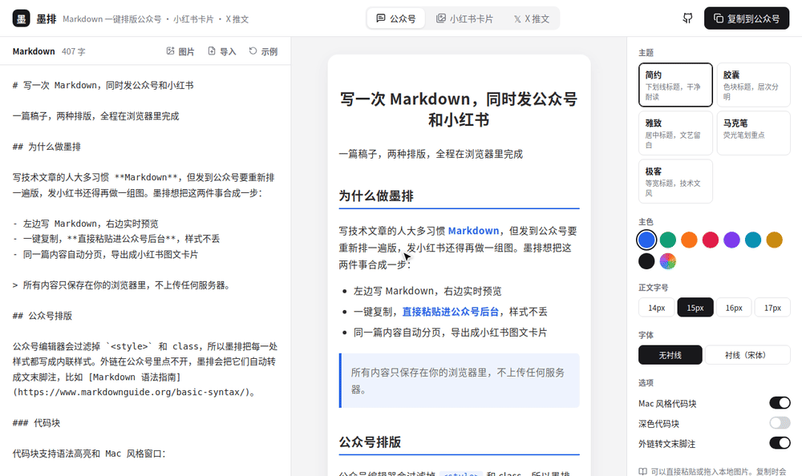

<div align="center">

# 墨排 Mopai

**写一次 Markdown，同时发公众号、小红书和 X。**

一键复制到微信公众号，样式不丢；同一篇文章自动分页，导出小红书图文卡片；也能拆成 X（Twitter）推文串。

纯前端 · 不用注册 · 内容不上传 · MIT 开源

**还能让 AI 直接用：** 命令行 + MCP 服务器，一句话把文章或 GitHub 仓库变成全套推广素材。

[在线使用](https://woodti.github.io/mopai/) · [English](#english)

<a href="https://linux.do/"></a>

</div>

<p align="center"></p>

## 功能

**公众号排版**

- 所有样式写成内联样式，粘贴到公众号后台不丢格式
- 5 套主题：简约、胶囊、雅致、马克笔、极客，主色随意换
- 代码块语法高亮，可选 Mac 风格窗口和深色配色，换行和缩进粘贴后保留
- 外链自动转为文末脚注（公众号正文里的外链点不开）
- 支持表格、任务列表、引用、图片说明

**小红书卡片**

- 按卡片高度自动分页：长段落按句子拆开，长代码按行拆开，长列表和表格按项拆开，序号跨页连续
- 第一个一级标题自动生成封面，下一行的短句作为副标题
- 3:4、1:1、9:16 三种尺寸，导出 1080px 宽高清 PNG
- 米白纸、纯白、方格本、主色浅底、夜读 5 种背景
- 单独一行 `---` 手动分页
- 单张下载或批量导出 ZIP

**X 推文串**

- 按 X 的计数规则拆条：中文和 emoji 算 2，链接固定算 23，每条不超过 280
- 优先按段落拆，太长再按句子拆；标题和后面的正文放在同一条
- 粗体、斜体转成 Unicode 粗体字符（英文和数字），X 上也能显示
- 可以加 `1/n` 编号和首条 🧵，每条单独复制，已复制的打勾
- Premium 用户可以切换成长推，不拆分

## 让 AI 帮你推广：命令行和 MCP

### 命令行

```bash
# 一篇 Markdown → 公众号排版 + 小红书卡片 + X 推文串
npx mopai post.md

# 一个 GitHub 仓库 → 全套推广素材（推广文案、卡片、推文串）
npx mopai repo owner/repo

# 只要小红书卡片，换个主题和背景
npx mopai post.md --only xhs --theme marker --color orange --bg grid --author @你的名字
```

输出在 `./mopai-out/<标题>/` 下：

| 文件 | 用法 |
| --- | --- |
| `wechat.html` | 用浏览器打开，点「复制到公众号」，去后台粘贴 |
| `xiaohongshu/01.png …` | 小红书卡片，1080px 宽 |
| `x-thread.txt` | 推文串，每条之间用分隔线隔开 |
| `source.md` | `repo` 命令生成的推广文案，改完后可以用 `npx mopai source.md` 重新生成 |

Markdown 里的本地图片和网络图片都会自动嵌入，没有跨域问题。运行 `npx mopai --help` 查看全部选项。

### MCP：在 Claude、Cursor 里直接用

Claude Code：

```bash
claude mcp add mopai -- npx -y mopai mcp
```

Claude Desktop、Cursor 等客户端，在 MCP 配置里加上：

```json
{
  "mcpServers": {
    "mopai": { "command": "npx", "args": ["-y", "mopai", "mcp"] }
  }
}
```

然后就可以直接说：

> 读一下 woodti/mopai 这个仓库，写一篇口语化的小红书推广文案，生成卡片，再拆一版 X 推文串。

| 工具 | 作用 |
| --- | --- |
| `get_github_repo` | 读取仓库信息、README 和推广草稿，AI 据此改写文案 |
| `render_xiaohongshu_cards` | Markdown → 小红书卡片 PNG，同时返回封面预览 |
| `render_wechat_article` | Markdown → 带复制按钮的公众号排版页面 |
| `render_x_thread` | Markdown → X 推文串 |
| `promote_github_repo` | 一步到位：仓库 → 全套推广素材 |

**环境要求**：Node.js 18+。生成卡片和公众号排版需要本机装有 Chrome 或 Edge；都没有的话，运行 `npx playwright install chromium`，或者用环境变量 `MOPAI_CHROME` 指定浏览器路径。读取仓库时可以设置 `GITHUB_TOKEN`，避开 GitHub 接口每小时 60 次的限制。

## 本地运行

需要 Node.js 20 或更高版本。

```bash
npm install
npm run dev
```

构建产物在 `dist/`，可以部署到任意静态托管（GitHub Pages、Vercel、Netlify、Cloudflare Pages、EdgeOne）。仓库已经带了 GitHub Pages 的 Actions 配置，推送到 `main` 后会自动部署。启用方法：仓库的 Settings → Pages → Source 选 **GitHub Actions**。

## 代码结构

| 文件 | 作用 |
| --- | --- |
| `src/markdown.ts` | Markdown → 带内联样式的 HTML：清理、代码高亮、脚注、公众号兼容处理 |
| `src/themes.ts` | 主题样式表、代码配色 |
| `src/cards.ts` | 小红书卡片分页引擎：在隐藏容器里实测高度，按块和句子拆分 |
| `src/CardsView.tsx` | 卡片渲染与 PNG / ZIP 导出 |
| `src/tweets.ts` | Markdown → X 推文串：加权计数、拆条、Unicode 粗体 |
| `src/XView.tsx` | 推文串预览与逐条复制 |
| `src/App.tsx` | 编辑器、预览、设置面板 |
| `src/repo.ts` | GitHub 仓库 → 推广文案 |
| `src/headless.tsx` | 无头渲染入口，命令行和 MCP 通过它调用排版引擎 |
| `cli/` | 命令行、MCP 服务器、本地渲染（无头浏览器） |

## 加一套主题

在 `src/themes.ts` 的 `THEMES` 里加一项，再在 `buildStyles` 的 `switch` 里覆盖需要改的元素样式（`h1`、`h2`、`blockquote`、`strong` 等）。欢迎 PR。

## 已知限制

- 小红书卡片里的网络图片需要图源允许跨域，否则导出时图片会缺失
- 本地图片还不能直接粘贴到编辑器（在计划中）

## 路线图

- [ ] 粘贴 / 拖入本地图片
- [ ] 更多卡片模板
- [ ] 自定义 CSS 主题
- [ ] 数学公式、Mermaid 图表

---

## English

**Mopai** turns one Markdown article into three outputs:

- **WeChat Official Account**: rich text with every style inlined, so it survives pasting into the WeChat editor. Includes 5 themes, syntax-highlighted code blocks, and external links converted to footnotes.
- **Xiaohongshu (RedNote) carousel cards**: content auto-paginated by measured height (paragraphs split by sentence, code by line, lists by item). Exports 1080px PNG files one at a time or as a ZIP.
- **X (Twitter) threads**: split by X's weighted character count (CJK counts as 2, URLs as 23), with `1/n` numbering and Unicode bold, plus copy buttons for each tweet.

Everything runs in the browser. Nothing is uploaded.

**For AI agents and the command line**, Mopai also ships a CLI and an MCP server:

```bash
npx mopai post.md                 # WeChat HTML + Xiaohongshu PNG cards + X thread
npx mopai repo owner/repo         # promo kit for any GitHub repository
claude mcp add mopai -- npx -y mopai mcp
```

MCP tools: `get_github_repo`, `render_xiaohongshu_cards`, `render_wechat_article`, `render_x_thread`, `promote_github_repo`. Rendering needs a local Chrome or Edge, or run `npx playwright install chromium`.

## 致谢

本项目分享于 [LINUX DO](https://linux.do/) —— 真诚、友善、团结、专业的技术社区。

## License

[MIT](LICENSE)
